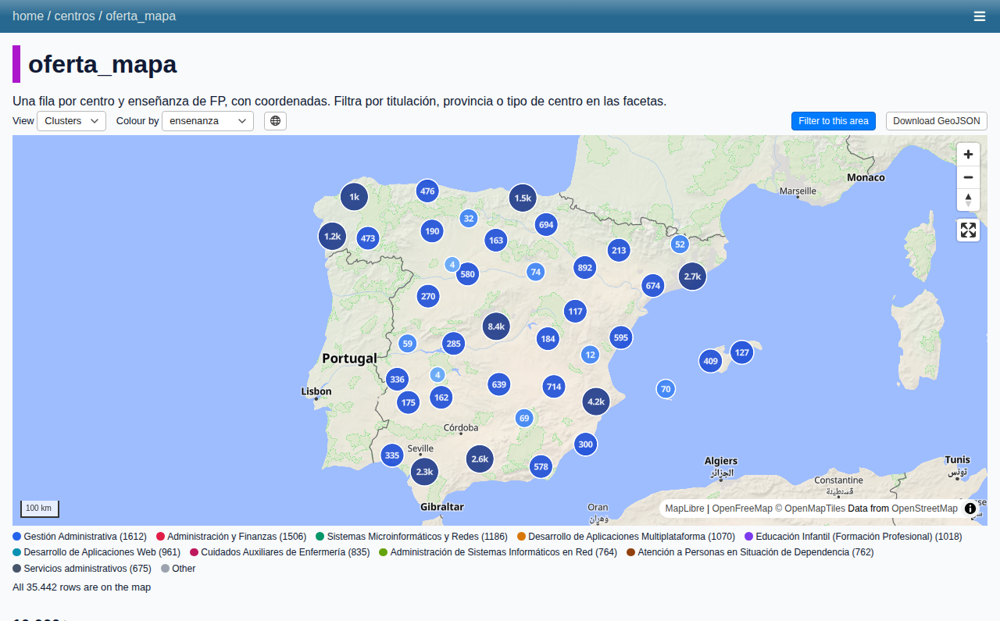

# todo-fp-map

Qué centros imparten qué en España, en una base SQLite con dirección y
coordenadas: **4.646 centros de Formación Profesional y 292 titulaciones
distintas**, sacados del registro oficial del Ministerio de Educación.

## Mapa

Datos del curso 2024/2025. No hay que instalar nada: Datasette corre en el
navegador y la base de datos (10 MB) se descarga desde un gist.

| Vista | Qué muestra | Abrir |
|---|---|---|
| **Por titulación** | 35.442 filas: un centro y una titulación de FP por fila. Es la vista para responder *"¿dónde se estudia X?"* | **[Abrir el mapa →](https://lite.datasette.io/?install=datasette-maplibre&s.settings.max_returned_rows=40000&s.plugins.datasette-maplibre.container=div.metadata-description&url=https://gist.githubusercontent.com/pcaro/266193048dfaef5cdc7e9d494f2cb207/raw/centros.sqlite&metadata=https://gist.githubusercontent.com/pcaro/266193048dfaef5cdc7e9d494f2cb207/raw/metadata.yml#/centros/oferta_mapa?_facet=ensenanza&_facet=provincia&_facet=naturaleza&_facet_size=8%23map=4.9/40.3/-3.6&color=ensenanza)** |
| **Por centro** | 4.646 puntos, un centro por fila, con `n_ensenanzas` (cuántas titulaciones de FP imparte) | **[Abrir el mapa →](https://lite.datasette.io/?install=datasette-maplibre&s.settings.max_returned_rows=40000&s.plugins.datasette-maplibre.container=div.metadata-description&url=https://gist.githubusercontent.com/pcaro/266193048dfaef5cdc7e9d494f2cb207/raw/centros.sqlite&metadata=https://gist.githubusercontent.com/pcaro/266193048dfaef5cdc7e9d494f2cb207/raw/metadata.yml#/centros/mapa?_facet=provincia&_facet_size=8%23map=4.9/40.3/-3.6&color=provincia)** |

[](https://lite.datasette.io/?install=datasette-maplibre&s.settings.max_returned_rows=40000&s.plugins.datasette-maplibre.container=div.metadata-description&url=https://gist.githubusercontent.com/pcaro/266193048dfaef5cdc7e9d494f2cb207/raw/centros.sqlite&metadata=https://gist.githubusercontent.com/pcaro/266193048dfaef5cdc7e9d494f2cb207/raw/metadata.yml#/centros/oferta_mapa?_facet=ensenanza&_facet=provincia&_facet=naturaleza&_facet_size=8%23map=4.9/40.3/-3.6&color=ensenanza)

## Cómo usarlo

Al abrir el enlace, el mapa aparece justo debajo del título con todos los puntos
cargados (*"All 35.442 rows are on the map"*). Debajo están la tabla y las
facetas: **las facetas filtran el mapa en el momento**.

### Filtrar por provincia

Despliega la faceta **provincia** y pincha una. El mapa se queda con los centros
de esa provincia y la tabla con sus filas. Puedes combinar varias facetas a la
vez (por ejemplo, provincia + titulación) y quitarlas con la **✕** de cada una.

### Filtrar por titulación

La faceta **ensenanza** es la titulación ("Gestión Administrativa",
"Administración y Finanzas", "Desarrollo de Aplicaciones Web"…). Hay 292, así
que el buscador de la propia faceta es lo más rápido: escribe las primeras
letras y Datasette filtra la lista. Para ir por ciclos completos, usa la faceta
**grado** (básico, medio, superior, cursos de especialización).

### Filtrar por tipo de centro

La faceta **naturaleza** separa **centro público**, **centro privado** y **centro
concertado**. Además, entre las "Suggested facets" tienes **tipo_centro** (IES,
centro integrado de FP, centro privado de FP…) y **modalidad** (presencial
diurno, semipresencial, distancia, dual).

### El mapa

- **Colour by**: colorea los puntos por cualquier columna. Por defecto
  `ensenanza`; con `provincia` o `naturaleza` se ve mejor la distribución. La
  leyenda de abajo trae los conteos.
- **View**: `Clusters` agrupa los puntos cercanos y enseña cuántos hay dentro;
  `Points` los pinta sueltos; `Heatmap` da densidad.
- **Filter to this area**: recarga la tabla con los centros del encuadre actual.
  Es la forma de "qué hay en esta comarca" sin saber el nombre del municipio.
- **Download GeoJSON**: todo lo que está en el mapa, con sus columnas, para
  abrirlo en QGIS.
- Click en un punto: popup con el centro, la titulación, la dirección y la
  precisión de la coordenada. Arrastrando con el botón derecho se inclina a 3D.

### Lo que no está

Solo Formación Profesional: ciclos de grado básico, medio y superior (LOE, LOGSE
y LFP) y cursos de especialización. Quedan fuera ESO, Bachillerato, Primaria,
Infantil, adultos, idiomas, música, danza, artes plásticas y enseñanzas
deportivas. Los datos completos están en la tabla `oferta` (`es_fp` marca lo que
es FP), y `todofp mapa --todo` reconstruye el mapa sin filtrar.

## Datos

- **4.646 centros** de FP geolocalizados (de 4.893 que imparten FP; 247 sin
  coordenadas). En total la base registra **35.310 centros** y **135.336
  enseñanzas**.
- **292 titulaciones** distintas.
- Cobertura de coordenadas: 92,8 % de todo el registro. Precisión: 16.597 en el
  portal exacto, 7.062 oficiales del directorio andaluz, 2.647 a nivel de calle,
  2.397 de localidad y 4.081 en el centro del municipio (direcciones `s/n`).
- Fuente: buscador de centros del Ministerio de Educación y Formación
  Profesional, curso 2024/2025.

## Instalación

Necesitas [uv](https://docs.astral.sh/uv/). Nada más.

```bash
uv sync
```

## Uso del script

Toda España:

```bash
uv run todofp fetch --ccaa "" --concurrencia 6   # 1 + 35.310 peticiones, ~17 min
uv run todofp geocode --ccaa "" --concurrencia 6 # CSV andaluz + CartoCiudad, ~1,5 h
uv run todofp mapa                               # tablas mapa y oferta_mapa (solo FP)
uv run todofp stats
```

Una comunidad (01 = Andalucía, es el valor por defecto):

```bash
uv run todofp build --ccaa 01
```

Prueba rápida con un puñado de centros:

```bash
uv run todofp build --ccaa 01 --limite 20
```

| Paso | Peticiones | Qué obtiene |
|---|---|---|
| `fetch` | 1 + una por centro | Listado (código, denominación, domicilio, CP, teléfono) y ficha con grado, familia, enseñanza y modalidad |
| `geocode` | 1 descarga + ~1 por centro | `lat`/`lng` con precisión: `oficial`, `portal`, `callejero`, `localidad`, `municipio` |
| `mapa` | 0 | `mapa` (un punto por centro) y `oferta_mapa` (centro × enseñanza), solo FP |

Reanudable: si cortas `fetch` o `geocode`, vuelve a lanzarlo y sigue donde lo
dejó (`detalle_ok` marca las fichas descargadas y el geocode solo toca
`lat IS NULL`). `--refrescar` vuelve a bajar fichas; `--rehacer` borra las
coordenadas.

## Esquema

```sql
centros(codigo PK, ccaa, provincia, municipio, localidad, denominacion,
        denominacion_generica, naturaleza, concertado, tipo_centro, domicilio,
        cod_postal, telefono, fax, email, web, lat, lng, geo_fuente,
        geo_precision, detalle_ok, actualizado)

oferta(centro_codigo, grado, familia, ensenanza, modalidad, es_fp)  -- PK compuesta

mapa(codigo, denominacion, municipio, provincia, naturaleza, tipo_centro,
     domicilio, cod_postal, n_ensenanzas, lat, lng, geo_precision)

oferta_mapa(centro_codigo, denominacion, municipio, localidad, provincia,
            naturaleza, tipo_centro, domicilio, cod_postal, grado, familia,
            ensenanza, modalidad, lat, lng, geo_precision, geo_fuente)
```

`mapa` y `oferta_mapa` son **tablas**, no vistas, porque Datasette no ofrece
facetas sobre vistas. `oferta.es_fp` se calcula con `db.es_fp()` a partir del
grado; ambas tablas se construyen filtrando por ahí.

## Verlo en local con Datasette

```bash
uv run datasette centros.sqlite --metadata datasette/metadata.yml \
  --setting max_returned_rows 40000 --port 8001
# http://127.0.0.1:8001/centros/oferta_mapa?_facet=ensenanza&_facet=provincia&_facet=naturaleza
```

`datasette` y `datasette-maplibre` están en las dependencias de desarrollo, así
que el `uv sync` ya los deja listos y el mapa sale igual que en Lite (misma
versión, 1.0a43). En local se usa `centros.sqlite` completo; `todofp lite` solo
hace falta para publicar.

## Cómo está montado

La fuente es el [buscador de centros del Ministerio de
Educación](https://todofp.es/que-estudiar/grados-d.html), que expone el registro
estatal completo en tres endpoints POST sin documentar: uno que devuelve el
listado en Excel (35.317 filas con dirección y teléfono), otro con la ficha de
cada centro (con la tabla de enseñanzas) y el formulario de filtros, de donde
salen los códigos de comunidad, familia y enseñanza.

La URL de Datasette Lite tiene cinco partes que importan:

| Parámetro | Para qué |
|---|---|
| `install=datasette-maplibre` | plugin que pinta el mapa (MapLibre + OpenFreeMap). Sin esto no hay mapa |
| `s.plugins.datasette-maplibre.container=div.metadata-description` | mueve el mapa de debajo de las facetas a debajo del título |
| `s.settings.max_returned_rows=40000` | sin esto Datasette corta en 1.000 filas y el mapa sale incompleto |
| `url=` / `metadata=` | la BD y el metadata, desde el gist (sirve CORS abierto) |
| `#/centros/oferta_mapa?...` | la tabla y las facetas iniciales. `%23map=z/lat/lng` y `&color=` son del plugin |

Los `?s.*` solo funcionan en Datasette 1.0a8+, por eso **no** se pone
`?ref=stable`. `uv run todofp url <gist>` genera los dos enlaces (y con
`--estable` la variante 0.65, que se queda en 1.000 puntos).

## Publicar una versión nueva

```bash
uv run todofp lite    # data/centros.sqlite
```

`gh gist create` **no acepta binarios**, así que el .sqlite se sube con git (un
gist es un repo git) usando el helper de credenciales de `gh`:

```bash
URL=$(gh gist create datasette/metadata.yml \
        --desc "Centros de FP en España" | tail -1)
git clone "$URL.git" /tmp/gist
cp data/centros.sqlite datasette/metadata.yml /tmp/gist/
cd /tmp/gist && git add -A && git commit -m "Añade la base de datos" && git push
uv run todofp url "$URL"
```

### Límites de los gists (medidos, no supuestos)

| Límite | Valor | Comprobación |
|---|---|---|
| Tamaño por fichero | **100 MiB**, bloqueado en el push | 105 MiB → `pre-receive hook declined` |
| Aviso al pasar de 50 MiB | warning `GH001`, pero sube | 60 MiB → push OK en 6 s |
| Subida por la web | 25 MiB | documentación de GitHub |
| Ficheros por gist / gists por cuenta | sin límite documentado | — |
| `raw` de un gist | fichero entero, con `Range` y CORS `*` | 60 MiB descargados, md5 idéntico, 206 parcial |

Un gist es un repo git y **el histórico cuenta**: publicar cada día 10 MB deja
los blobs ahí. Si se itera mucho, conviene un gist nuevo por versión.

## Notas sobre las fuentes

- **Ministerio** (`www.educacion.gob.es/centros`): sin `robots.txt`, pero es un
  servicio público. El script manda `User-Agent` identificable, concurrencia
  moderada y reintentos con espera.
- **CartoCiudad** devuelve 0,0 en `candidatesJsonp` para todo lo que no sea un
  portal; por eso usamos `findJsonp`, que sí trae centroide de calle y municipio.
  El campo `domicilio` viene con `s/n`, `NO CONSTA` y similares:
  `normaliza_direccion()` los limpia antes de consultar. Cada resultado se
  valida contra el código de provincia del centro (los dos primeros dígitos del
  código son el código INE); sin eso, una calle homónima lo coloca a 300 km.
- **Andalucía** publica su directorio con `N_LATITUD`/`N_LONGITUD` oficiales
  (curso 2024/2025), así que esos centros no pasan por el geocodificador.

## Pendiente

- Subir el 92,8 % de cobertura de coordenadas añadiendo los directorios con
  geometría del resto de CCAA (Euskadi, Catalunya, Valencia, Madrid, Galicia…
  publican CSV o Shapefile).
- Los 4.081 centros en precisión `municipio` tienen dirección `s/n`: se puede
  intentar casarlos con los POI `amenity=school` de OSM.
- Mapear los códigos `ensenanza` del formulario (270) a los enlaces de todofp
  (`ensenanzaFP=121_2101`) para cruzar con la oferta formativa publicada.
- Decidir si se parte la base por comunidades o grupos de ellas cuando crezca.
